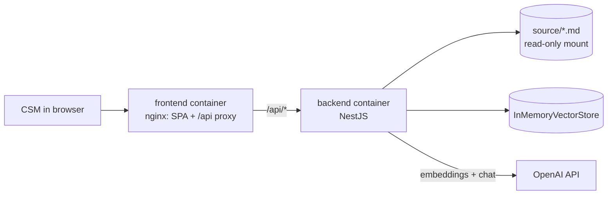
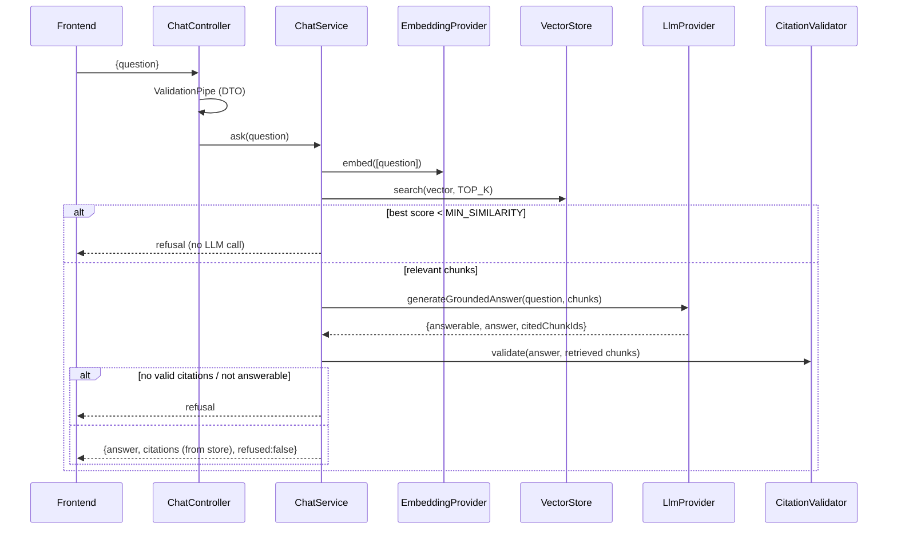

# Architecture

OmniCorp SmartSearch is split into three concerns: **backend** (NestJS API), **frontend** (React SPA) and
**documentation** (`docs/`, plus the knowledge base in `source/`). See ADR-0002 for the layout decision and
ADR-0003 for the RAG design.

## Components

The browser only talks to its own origin. nginx forwards `/api` to the backend, and only the backend holds the
OpenAI key.

## Backend modules (`backend/src`)

| Module | Responsibility | Key types |
| --- | --- | --- |
| `config` | Load and validate env with zod; typed `AppConfigService` | `Env`, `validateEnv` |
| `documents` | Read `.md` files, parse front-matter, chunk, orchestrate reload, list metadata | `DocumentLoaderService`, `ChunkerService`, `DocumentsService` |
| `embeddings` | `EmbeddingProvider` abstraction + OpenAI implementation (batched) | `EmbeddingProvider`, `OpenAiEmbeddingProvider` |
| `vector-store` | `VectorStore` abstraction + in-memory cosine search | `VectorStore`, `InMemoryVectorStore` |
| `llm` | `LlmProvider` abstraction + OpenAI Structured Outputs implementation; prompts | `LlmProvider`, `OpenAiLlmProvider` |
| `chat` | RAG pipeline, citation validation, `/api/chat` | `ChatService`, `CitationValidator` |
| `health` | Liveness + knowledge-base status | `HealthController` |
| `common` | Global exception filter, OpenAI client and error mapping | `AllExceptionsFilter`, `mapOpenAiError` |

The providers (`EmbeddingProvider`, `LlmProvider`, `VectorStore`) are abstract classes that also serve as Nest DI
tokens. Feature code never imports the `openai` SDK directly. Changing vendor or storage means binding a different
class in that module. Tests use the same mechanism to inject fakes.

## Request flow: `POST /api/chat`

## Ingestion flow: `POST /api/documents/reload`

1. `DocumentLoaderService` reads `SOURCE_DIR/*.md` (sorted), strips front-matter, resolves the title and derives `sourceId` from the file name.
2. `ChunkerService` splits each document at headings, then packs paragraphs into chunks of about `CHUNK_SIZE` characters with `CHUNK_OVERLAP`.
3. `EmbeddingProvider.embed` embeds `"<title> > <heading path>\n\n<text>"` for every chunk.
4. `VectorStore.replaceAll` swaps the whole index in one step. If any step fails, the previous index keeps serving.
5. A lock rejects a concurrent reload with `409`.

Ingestion also runs on startup (not awaited, so the API is reachable immediately; `/api/health` shows the status).

## Frontend (`frontend/src`)

- `features/chat`: `ChatPage`, `MessageList`, `MessageBubble`, `AnswerText` (turns `[chunk-id]` markers into numbered links), `CitationList`, `ChatInput`, `useChat`.
- `features/documents`: `DocumentsPanel` (metadata table + Reload), `useDocuments` / `useReloadDocuments` (TanStack Query).
- `lib/http.ts`: typed `fetch` wrapper that turns the backend error body into an `ApiError`.
- Layout: the documents panel is a sidebar at `lg` and above, and a slide-over drawer on smaller screens.

## Deployment

`docker-compose.yml` builds two images:

- **backend**: multi-stage `node:22-alpine`, production dependencies only, non-root user, healthcheck on `/api/health`.
- **frontend**: built on `node:22-slim`, served by `nginx:1.27-alpine` with security headers and the `/api` proxy.

The frontend waits for the backend healthcheck. `source/` is mounted read-only into the backend.

## Known limitations (MVP)

- The vector store is in-memory and per-process: it is rebuilt on every start and doesn't scale horizontally.
- Conversations are single-turn. History is kept only in the browser and is not sent to the model.
- There is no authentication. The app is meant to run on an internal network or behind an SSO proxy.
